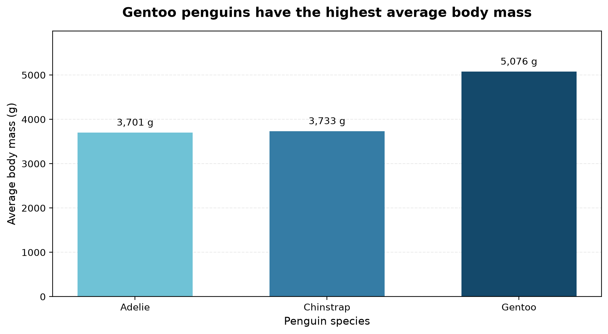
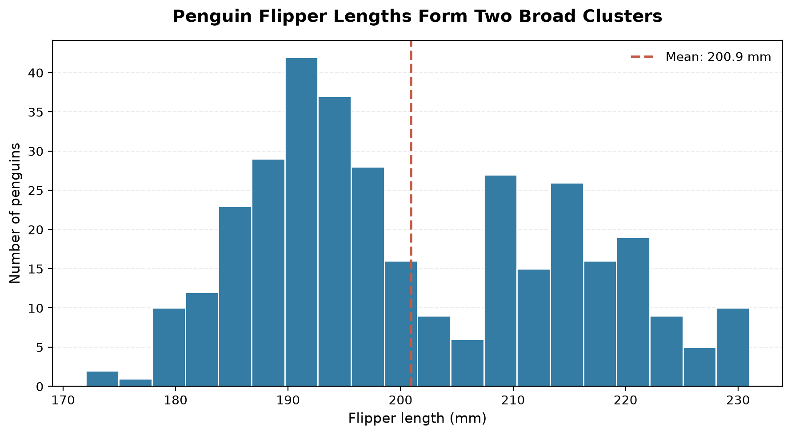
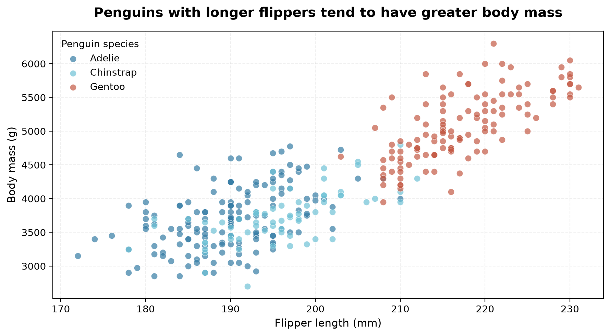

# Palmer Penguins: Exploratory Data Analysis Using Pandas

**Author:** Clinton Njoku  
**Programme:** My AI Engineering Journey. 
**Practice:** Session 4 — Pandas: Working With Real Data

## 1. Project Overview

This project explores the Palmer Penguins dataset using Python and Pandas. The objective is to practise loading, inspecting, cleaning, filtering and grouping real-world data, then communicate the findings clearly.

The analysis investigates differences in body mass and flipper length across species, islands and recorded sex, as well as the relationship
between physical measurements. Seven analytical questions are explored.

## 2. Dataset Description

**Source:** [Palmer Penguins dataset — seaborn-data on GitHub](https://github.com/mwaskom/seaborn-data/blob/master/penguins.csv)

The dataset includes measurements for three penguin species: Adelie, Chinstrap and Gentoo. The recorded variables are species, island, bill length, bill depth, flipper length, body mass and sex.

The original dataset contains **344 records and 7 columns**. Following cleaning, **342 records** remain available for analysis.

## 3. Data Inspection and Cleaning

The dataset was inspected using `shape`, `head()`, `info()`, `describe()`, `isna().sum()`, `value_counts()` and `duplicated().sum()`.

The inspection identified:

- Two records with all four physical measurements missing.
- Eleven records with missing sex information, including the two records with missing measurements.
- Zero exact duplicate rows.
- Appropriate numerical and categorical data types.

**Cleaning decisions:** The two records lacking physical measurements were removed because those measurements were necessary for the analysis. Nine records missing only sex information were retained because their physical measurements remained useful. No imputation or data-type conversion was necessary.

The cleaned dataset contains 342 records and 7 columns, with nine missing sex values remaining. The original CSV was preserved separately.

## 4. Research Questions and Findings

### Question 1: What is the average body mass of each penguin species?

| Species | Average body mass |
|---|---:|
| Adelie | 3,700.66 g |
| Chinstrap | 3,733.09 g |
| Gentoo | 5,076.02 g |

**Finding:** Gentoo penguins have the highest average body mass, approximately 1.38 kg heavier than Adelie penguins. Chinstrap and Adelie have similar average body masses.

### Question 2: How does average flipper length vary across species?

| Species | Average flipper length |
|---|---:|
| Adelie | 189.95 mm |
| Chinstrap | 195.82 mm |
| Gentoo | 217.19 mm |

**Finding:** Gentoo penguins have the longest average flippers, approximately 27.24 mm longer than Adelie penguins. The results suggest that flipper length may help distinguish species, although individual measurements can overlap.

### Question 3: How many penguins weigh more than 5,000 grams, and which species do they belong to?

Of the 342 cleaned records, **61 penguins (17.84%)** weigh more than 5,000 g.

All 61 belong to the Gentoo species. No Adelie or Chinstrap penguins exceed this threshold in the dataset.

**Finding:** Body mass above 5,000 g is associated exclusively with Gentoo penguins in this sample. However, not every Gentoo penguin exceeds that weight.

### Question 4: How many Gentoo penguins have flippers longer than 220 mm?

There are 123 Gentoo penguins in the cleaned dataset.

Of these, **35 (28.46%)** have flippers longer than 220 mm, while 88 have flippers measuring 220 mm or less.

**Finding:** Although Gentoo penguins have the longest average flipper length, fewer than one-third exceed the 220 mm threshold.

### Question 5: How does average body mass vary by species and island?

| Species | Island | Records | Average body mass |
|---|---|---:|---:|
| Adelie | Biscoe | 44 | 3,709.66 g |
| Adelie | Dream | 56 | 3,688.39 g |
| Adelie | Torgersen | 51 | 3,706.37 g |
| Chinstrap | Dream | 68 | 3,733.09 g |
| Gentoo | Biscoe | 123 | 5,076.02 g |

**Finding:** Adelie penguins have similar average body masses across the three islands, with a maximum difference of only 21.27 g. Gentoo penguins on Biscoe Island have the highest group average.

An important limitation is that Gentoo penguins occur only on Biscoe Island and Chinstrap penguins only on Dream Island in this dataset. Consequently, species and island effects cannot be reliably separated through these simple group comparisons.

### Question 6: How does average body mass differ between male and female penguins within each species?

| Species | Female average | Male average | Male–female difference |
|---|---:|---:|---:|
| Adelie | 3,368.84 g | 4,043.49 g | 674.66 g |
| Chinstrap | 3,527.21 g | 3,938.97 g | 411.76 g |
| Gentoo | 4,679.74 g | 5,484.84 g | 805.09 g |

**Finding:** Among 333 penguins with recorded sex, males have
a higher average body mass than females in all three species.
The largest difference occurs among Gentoo penguins (805.09 g),
followed by Adelie (674.66 g) and Chinstrap (411.76 g).

Nine records with missing sex information were excluded only
from this comparison.

### Question 7: What is the relationship between flipper length and body mass?

| Penguin group | Pearson correlation (r) | Records |
|---|---:|---:|
| All penguins | 0.871 | 342 |
| Adelie | 0.468 | 151 |
| Chinstrap | 0.642 | 68 |
| Gentoo | 0.703 | 123 |

**Finding:** A strong positive correlation exists between flipper
length and body mass across all penguins (r = 0.871).
However, correlations within individual species are lower.

This suggests that differences between species contribute to
the strong overall relationship. Longer flippers are generally
associated with greater body mass, but correlation does not
establish causation.

## 5. Limitations

The analysis is descriptive rather than causal. Observed differences do not establish why penguin measurements vary.

Species and island are associated in the dataset, limiting direct comparisons of island effects. Missing sex information was retained, and no formal statistical significance tests were performed.

## 6. Future Investigations

With additional time, this project could be extended by:

- Creating charts to compare body mass and flipper length distributions.
- Examining relationships between body mass, bill measurements and flipper length.
- Investigating differences between male and female penguins while accounting for missing sex values.
- Evaluating whether physical measurements can predict penguin species using a machine learning classification model.

## 7. Project Files

- `data/penguins.csv` — Original dataset.
- `output/penguins_cleaned.csv` — Cleaned dataset.
- `penguins_analysis.py` — Inspection, cleaning and analytical code.
- `analysis_questions.md` — Seven research questions and analytical approach.
- `README.md` — Project documentation and findings.

## 8. Tools and Skills Demonstrated

**Tools:** Python, Pandas, Ubuntu (WSL2), VS Code and Git/GitHub.

**Skills:** CSV data loading, exploratory data analysis, missing-value assessment, duplicate checks, data cleaning, Boolean filtering, grouping, aggregation, reproducible analysis and technical documentation.

## 9. How to Reproduce This Analysis

### Tested Software Environment

This project was developed and tested using:

- **Python:** 3.14.4
- **Pandas:** 3.0.6
- **Matplotlib:** 3.11.2

The required Python libraries and their tested versions are recorded in [requirements.txt](requirements.txt).

To install the project dependencies from the repository root, run:

```bash
python -m pip install -r projects/01-data-exploration/requirements.txt
```

Using the documented versions helps reproduce the analysis and reduces compatibility differences between environments.

This project can be reproduced using Python and Pandas.

### Requirements

- Python 3.11 or later
- Pandas
- Git

### Run the Project

1. Clone the GitHub repository:

   git clone https://github.com/ClintonNjoku2020/ai-engineering-journey.git

2. Navigate to the project directory:

   cd ai-engineering-journey/projects/01-data-exploration

3. Create and activate a Python virtual environment:

   python3 -m venv venv
   source venv/bin/activate

4. Install Pandas:

   python -m pip install pandas

5. Run the analysis:

   python penguins_analysis.py

### Dataset Source

The original dataset is included in the `data/` directory
as `penguins.csv`.

It was obtained from:

https://raw.githubusercontent.com/mwaskom/seaborn-data/master/penguins.csv

To download a fresh copy, run:

   curl -fL https://raw.githubusercontent.com/mwaskom/seaborn-data/master/penguins.csv -o data/penguins.csv

The analysis script loads the dataset from the local `data/`
directory and saves the cleaned version to `output/`.

### Reproducibility Notes

The original CSV file is preserved to allow the cleaning
process to be repeated.

The analysis does not modify the source dataset.

The same cleaning and analytical procedures can be rerun
using the supplied Python script.


## Session 5 — Task B: Date Parsing and Data Reliability

### Objective

Demonstrate how incorrectly interpreting ambiguous dates can silently change analytical results, even when every date parses successfully.

### Experiment

Six dates were recorded in UK day/month/year format. Each date was deliberately chosen so that both the day and month were 12 or below.

The same dates were parsed using:

- **Correct interpretation:** `dayfirst=True`
- **Incorrect interpretation:** `dayfirst=False`

Both interpretations produced six valid dates and zero missing values (`NaT`).

### Monthly Record Count Comparison

| Month | Correct UK Parsing | Incorrect US Parsing | Difference |
|---|---:|---:|---:|
| January | 4 | 0 | -4 |
| February | 0 | 1 | +1 |
| March | 2 | 1 | -1 |
| April | 0 | 2 | +2 |
| May | 0 | 1 | +1 |
| June | 0 | 1 | +1 |
| July–December | 0 | 0 | 0 |
| **Total** | **6** | **6** | **0** |

### Findings and Data Reliability

The experiment demonstrates a silent data-quality error: every date remains valid, but records are assigned to incorrect months.

For example, `03/01/2026` represents 3 January 2026 in UK format but becomes 1 March 2026 when interpreted using US conventions.

This is particularly dangerous because the dataset contains no parsing failures, no missing dates, and no lost records. Simple validation checks may therefore pass while monthly trends and business conclusions become incorrect.

Date formats should be established from the data source, and date-parsing assumptions should be tested before using external data for analysis.

### Reproducibility

**Script:** [date_parsing_experiment.py](date_parsing_experiment.py)

Run from the repository root:

```bash
python projects/01-data-exploration/date_parsing_experiment.py
```

## Session 5 — Task C: Merging Two Datasets

### Objective

To combine penguin observations with a species reference table, compare inner and left joins, and answer an analytical question requiring information from both datasets.

### Datasets

- **Primary dataset:** `data/penguins.csv` — 344 observations and 7 columns.
- **Reference dataset:** `data/species_reference.csv` — 4 species and 2 columns.
- **Merge key:** `species`.

The reference dataset provides scientific genus information that is absent from the original Penguins dataset.

### Merge Method and Validation

Both inner and left joins were performed using Pandas `merge()`, with `validate="many_to_one"` to prevent unintended duplication of observations.

| Metric | Result |
|---|---:|
| Original penguin observations | 344 |
| Inner join rows | 344 |
| Left join rows | 344 |
| Difference in row counts | 0 |
| Unmatched penguin observations | 0 |

**Selected join: Left join.** A left join was chosen to preserve all original penguin observations while enriching them with scientific genus information. Although both joins produced identical row counts in this experiment, a left join would retain unmatched observations in future datasets.

### Analytical Question

**What percentage of observed penguins belongs to each scientific genus, using the external species reference table?**

This question genuinely requires both datasets:

- The Penguins dataset provides the individual observations and species names.
- The species reference dataset provides the scientific genus for each species.

Neither dataset alone contains both the observation counts and the genus classification.

### Genus-Level Analysis

| Genus | Observations | Observed Species | Percentage |
|---|---:|---:|---:|
| Pygoscelis | 344 | 3 | 100.00% |

All 344 observed penguins belong to the genus *Pygoscelis*, covering Adelie, Chinstrap and Gentoo.

The reference dataset also contains Emperor penguins, classified under *Aptenodytes*. However, Emperor penguins are absent from the observation dataset, so they do not contribute to the observed genus percentages.

This demonstrates how a reference table can provide classification information required for a new analysis.

### Synthetic Unmatched-Key Demonstration

A separate synthetic dataset was created to demonstrate the practical difference between inner and left joins.

The demonstration contains four observations, including one deliberately unmatched species called `Mystery`.

| Metric | Result |
|---|---:|
| Original synthetic observations | 4 |
| Inner join rows | 3 |
| Left join rows | 4 |
| Difference | 1 |
| Unmatched species | Mystery |

The inner join removes the unmatched `Mystery` observation because its key does not exist in the reference table.

The left join retains all four observations, assigning a missing genus (`NaN`) to `Mystery` and marking it as `left_only` in the merge indicator.

**Conclusion:** A left join is appropriate when the objective is to preserve all original observations, even if reference information is incomplete.

The synthetic demonstration is separate from the original Palmer Penguins dataset. No real penguin observations or reference records were modified.

### Reproducibility

- [Create Species Reference Table](create_species_reference.py)
- [Merge and Analyse Penguin Data](merge_penguins.py)

Run the scripts from the repository root using Python and Pandas.

## Session 5 — Task D: Data Visualisation

### Objective

Create three different Matplotlib visualisations from the Palmer Penguins dataset to communicate findings about body mass, flipper length distribution, and the relationship between physical measurements.

### Chart 1: Gentoo Penguins Have the Highest Average Body Mass



Gentoo penguins have the highest average body mass at 5,076.02 g, compared with 3,733.09 g for Chinstrap and 3,700.66 g for Adelie penguins. This comparison highlights important differences in body mass between the three species.

### Chart 2: Flipper Length Distribution Shows Two Broad Clusters



The histogram of 342 valid measurements shows two broad concentrations of flipper lengths, approximately around 190–195 mm and 210–220 mm, with an overall mean of 200.92 mm. This suggests that the population contains groups with different typical flipper lengths and that the overall mean does not fully describe the distribution.

### Chart 3: Longer Flippers Are Associated with Greater Body Mass



The scatter plot shows a strong positive overall relationship between flipper length and body mass, with a Pearson correlation coefficient of 0.871 across 342 complete observations. The species-coloured clusters indicate that differences between penguin species contribute to the observed relationship, so the correlation should not be interpreted as evidence of causation.

### Reproducibility

All three charts were generated using Matplotlib and saved as PNG files in the `output/` directory.

**Python script:** [create_charts.py](create_charts.py)

To reproduce the charts from the repository root:

```bash
python projects/01-data-exploration/create_charts.py
```

Missing numerical measurements were excluded from the relevant calculations without altering the original dataset.