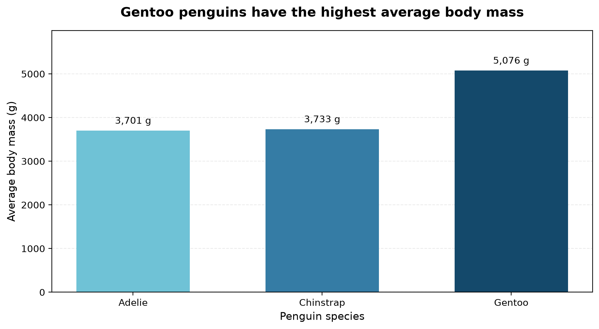
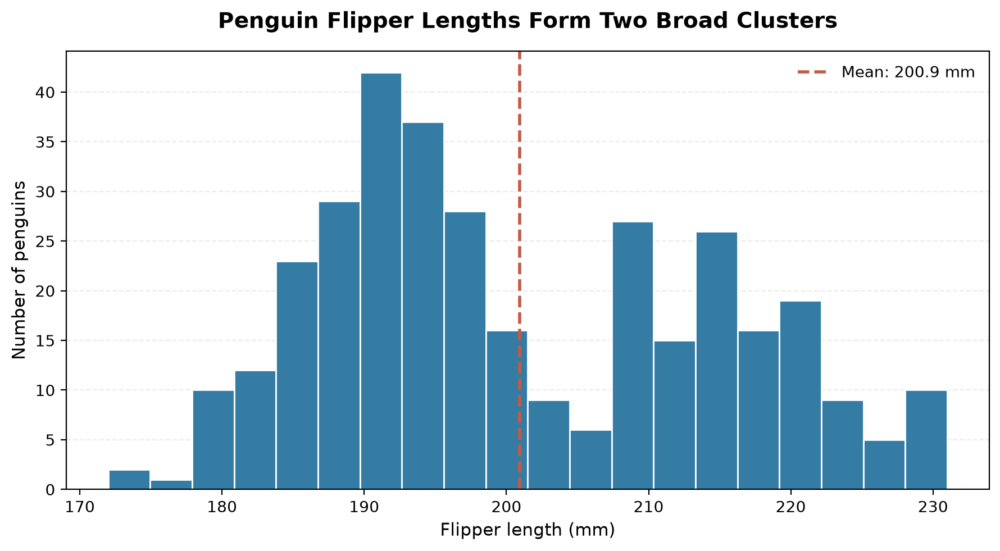
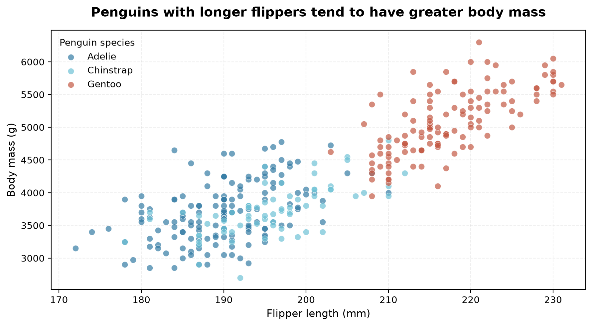

# Palmer Penguins — Exploratory Data Analysis

**Python | Pandas | NumPy | Matplotlib | Data Cleaning | Data Visualisation**

**Author:** Clinton Njoku  
**Programme:** Refonte Learning — AI Engineering Training and Internship Programme

## 1. Project Overview

This project demonstrates an end-to-end exploratory data analysis (EDA) workflow using the Palmer Penguins dataset.

The objective is to inspect, clean, analyse and visualise real-world data, identify meaningful patterns, and communicate findings clearly.

The project also demonstrates reusable Python functions, data quality validation, dataset merging and reproducible analytical workflows.

**Key skills demonstrated:** Data cleaning, statistical analysis, Pandas aggregation, data visualisation, input validation and technical documentation.

## 2. Dataset

**Source:** [Palmer Penguins dataset](https://github.com/mwaskom/seaborn-data/blob/master/penguins.csv)

The dataset contains observations of three penguin species:

- Adelie
- Chinstrap
- Gentoo

Seven variables are recorded:

| Variable | Description |
|---|---|
| species | Penguin species |
| island | Island of observation |
| bill_length_mm | Bill length in millimetres |
| bill_depth_mm | Bill depth in millimetres |
| flipper_length_mm | Flipper length in millimetres |
| body_mass_g | Body mass in grams |
| sex | Recorded sex |

### Data Cleaning

| Metric | Result |
|---|---:|
| Original records | 344 |
| Original columns | 7 |
| Records removed | 2 |
| Cleaned records | 342 |
| Exact duplicates | 0 |
| Remaining missing sex values | 9 |

Two records were removed because all four physical measurements were missing.

Nine records with missing sex values were retained because their remaining measurements were useful for other analyses.

The original dataset was preserved, and the cleaned dataset was saved separately.

**Technical decision:** Missing values were handled according to their relevance to the analytical questions, rather than removing every record containing any missing value.

## 3. Research Questions

The analysis investigates seven questions:

1. What is the average body mass of each penguin species?
2. How does average flipper length vary across species?
3. How many penguins weigh more than 5,000 grams?
4. What percentage of Gentoo penguins have flippers longer than 220 mm?
5. How does body mass vary by species and island?
6. How does average body mass differ between male and female penguins?
7. What is the relationship between flipper length and body mass?

These questions were investigated using filtering, grouping, aggregation and correlation analysis in Pandas.

## 4. Key Findings and Visualisations

### Finding 1 — Gentoo Penguins Have the Highest Average Body Mass

| Species | Average body mass |
|---|---:|
| Adelie | 3,700.66 g |
| Chinstrap | 3,733.09 g |
| Gentoo | 5,076.02 g |

Gentoo penguins are substantially heavier on average than the other two species in the dataset.

Of the 342 cleaned observations, 61 penguins weigh more than 5,000 g. All 61 belong to the Gentoo species.



### Finding 2 — Gentoo Penguins Have the Longest Average Flippers

| Species | Average flipper length |
|---|---:|
| Adelie | 189.95 mm |
| Chinstrap | 195.82 mm |
| Gentoo | 217.19 mm |

Gentoo penguins have the longest average flipper length.

Of 123 Gentoo penguins, 35 (28.46%) have flippers longer than 220 mm.

The flipper-length distribution shows that the overall population contains groups with different typical measurements.



### Finding 3 — Flipper Length and Body Mass Are Positively Correlated

The Pearson correlation coefficient between flipper length and body mass across all 342 cleaned observations is:

**r = 0.871**

Correlations within individual species are:

| Species | Pearson correlation |
|---|---:|
| Adelie | 0.468 |
| Chinstrap | 0.642 |
| Gentoo | 0.703 |

The overall relationship is stronger than the relationships observed within individual species.

This suggests that differences between species contribute to the overall correlation.



**Interpretation:** Longer flippers are generally associated with greater body mass, but correlation does not establish causation.

### Finding 4 — Body Mass Varies by Sex and Species

Among penguins with recorded sex, males have higher average body mass than females across all three species.

The largest difference occurs among Gentoo penguins, where the male average exceeds the female average by approximately 805 g.

Nine records with missing sex information were excluded from this comparison only.

### Finding 5 — Species and Island Must Be Considered Together

Adelie penguins have similar average body masses across Biscoe, Dream and Torgersen islands.

However, the observed Gentoo penguins occur only on Biscoe Island, while Chinstrap penguins occur only on Dream Island.

This limits the ability to separate species-related differences from island-related differences using simple descriptive comparisons.

### Additional Data Engineering Experiments

The project includes three supporting exercises.

**Reusable data cleaning:** A reusable `clean_data()` function standardises values, handles missing-value placeholders, converts numeric text and removes duplicate records.

**Date parsing:** An experiment demonstrates how incorrectly interpreting UK-formatted dates can silently distort monthly analytical results.

**Dataset merging:** Inner and left joins were compared using a species reference table. A left join was selected to preserve the original observations, and a synthetic unmatched-key example demonstrated the difference between join types.

Detailed methods, tables and results are available in the [Session 4 and 5 Technical Notes](docs/session4-5-technical-notes.md).

### Limitations

- The analysis is descriptive and does not establish causation.
- Species and island are associated within the dataset.
- Nine observations have missing sex information.
- No formal statistical significance tests were performed.
- Findings describe the available sample and should not be generalised without further investigation.

## 5. How to Run the Project

### Requirements

- Python 3.11 or later, with dependencies compatible with your Python version
- Git
- Pandas
- Matplotlib

The project was developed using Python 3.14.4, Pandas 3.0.6 and Matplotlib 3.11.2.

### Step 1 — Clone the Repository

```bash
git clone https://github.com/ClintonNjoku2020/ai-engineering-journey.git
cd ai-engineering-journey
```

### Step 2 — Create a Virtual Environment

```bash
python3 -m venv venv
source venv/bin/activate
```

### Step 3 — Install Dependencies

```bash
python -m pip install -r projects/01-data-exploration/requirements.txt
```

### Step 4 — Run the Analysis

```bash
python projects/01-data-exploration/penguins_analysis.py
```

### Step 5 — Generate the Charts

```bash
python projects/01-data-exploration/create_charts.py
```

### Step 6 — Run Supporting Experiments

```bash
python projects/01-data-exploration/test_clean.py
python projects/01-data-exploration/date_parsing_experiment.py
python projects/01-data-exploration/merge_penguins.py
```

All commands above should be executed from the repository root.

### Main Project Files

| File | Purpose |
|---|---|
| `penguins_analysis.py` | Data cleaning and exploratory analysis |
| `clean.py` | Reusable data cleaning function |
| `test_clean.py` | Cleaning function tests |
| `create_charts.py` | Data visualisation |
| `date_parsing_experiment.py` | Date reliability experiment |
| `merge_penguins.py` | Dataset merging and validation |
| `data/penguins.csv` | Original dataset |
| `data/species_reference.csv` | Species reference information |
| `output/` | Cleaned data and charts |

The original CSV is retained to support reproducibility.

## 6. Future Improvements

The next stages of this project could include:

1. **Automated testing:** Develop a structured test suite for cleaning and analytical functions.
2. **Data pipelines:** Build a repeatable pipeline for loading, validating, cleaning and preparing datasets.
3. **Feature engineering:** Create new features from penguin measurements.
4. **Machine learning:** Train classification models to predict penguin species.
5. **Model evaluation:** Compare classification performance using appropriate validation metrics.
6. **Deployment:** Develop a simple interactive application for exploring the dataset and its predictions.

## Conclusion

This project demonstrates the practical use of Python and Pandas to transform raw data into interpretable analytical findings.

It also provides a foundation for more advanced AI Engineering activities, including data pipelines, feature engineering and machine learning.

For detailed methods, validation decisions and Session 5 experiments, see the [Technical Notes](docs/session4-5-technical-notes.md).
